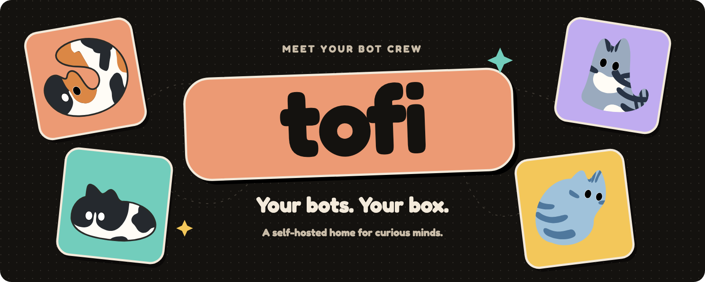

<p align="center"></p>

<p align="center">Persistent bots, conversations and connected tools — on your own server.</p>

TOFI is a self-hosted AI Bot workspace. You install it on a Linux server you own. Bots keep their identity, memory, schedules and tool connections there. Each account can have its own sandboxed computer (a Firecracker microVM with Chrome, a desktop and a terminal). Bots can work alone or as a group that splits a request into parts. You choose the model: sign in with ChatGPT, use an OpenAI or Anthropic key, or point TOFI at Ollama, LM Studio, vLLM or any OpenAI-compatible server. The server is Apache-2.0; the web app is PolyForm Shield.

Install on Ubuntu 22.04/24.04 or Debian 12/13 (x86_64 or aarch64) with one command. KVM is optional. See [Install](#install). Current release: [GitHub Releases](https://github.com/JackZhao98/tofibot/releases).

## See it work

Recorded on a live TOFI install. Watch the [95-second demo](https://tofibot.com/media/tofi-demo.mp4).

| Ask a Bot | A Bot uses its Bot computer | Bots hand work to Bots |
|---|---|---|
|  |  |  |

### Why not OpenClaw or Grok Bot?

| | Where Bots run | Models | Isolation |
|---|---|---|---|
| [OpenClaw](https://github.com/openclaw/openclaw) (MIT) | Any machine you own | Many providers | Docker sandbox is optional. Tools run on the host unless you [configure sandboxing](https://docs.openclaw.ai/gateway/sandboxing). |
| [Grok Bot](https://docs.x.ai/grok-bot/overview) | The computers Bots work on run in Cursor's cloud. All Bots of one account share one computer. | xAI | Vendor cloud |
| TOFI | A Linux server you own | ChatGPT sign-in, OpenAI or Anthropic key, Ollama, LM Studio, vLLM or any OpenAI-compatible server | One Firecracker microVM for each account (needs KVM). Without KVM, Bots work without a computer. |

OpenClaw has a much larger community and skill library. Grok Bot needs no install and has phone apps. TOFI has a web app only. Read [WHY-SELF-HOST.md](WHY-SELF-HOST.md) for what TOFI does better, what it does worse, and when to use something else.

- Direct and group conversations, streaming replies, attachments and generated files.
- Persistent queues, scheduled work, cancellation and retry handling.
- Bot configuration, memory and collaboration across conversations.
- MCP and Skills management, credentials and supported OAuth connections.
- Server-side web search and web fetch, with an ordered chain of providers.
- Invite-only accounts, Admin management and per-account data isolation.
- Optional: one Bot computer for each account. Today its kind is the built-in virtual
  machine (a Firecracker microVM on your server). Bots work without it.
- Local connections (for example Gmail through gog) run in a separate tool runner
  container, with or without a Bot computer. An admin can attach or detach a Bot computer
  while TOFI runs; the connections keep working.

## Install

Use a dedicated Linux server or VM. TOFI supports x86_64 and aarch64.
TOFI supports Ubuntu 22.04/24.04 and Debian 12/13.

TOFI runs without a Bot computer. The Bot computer (a virtual desktop for each account,
needs KVM) is an optional upgrade that you can add later. Its kind today is the
built-in VM.

### Option A: one-command installer

It installs Docker images, the `tofi` host tool, backups and updates.
It also sets up a Bot computer when the host has KVM.

```sh
curl -fsSL https://raw.githubusercontent.com/JackZhao98/tofibot/main/install.sh | sudo bash
```

The installer shows what it found on the machine. It asks how you want to open
TOFI. It changes nothing until you confirm. Then it prints the web addresses and
a one-time setup key. Open the address and enter the key. This creates the
Admin account. Then open Settings > Model provider.

By default TOFI serves HTTPS with a self-signed certificate on port 8321.
Compare the SHA-256 fingerprint that the installer prints with the one in your
browser. On a cloud server, allow TCP 8321 in the firewall.

There are three ways to open TOFI. Choose in the installer:

- **Tailscale (VPN):** best for phones. TOFI still listens on all interfaces, so close TCP 8321 at your firewall or cloud security group; Tailscale does not need it open. The certificate includes the Tailscale IP and MagicDNS name.
- **IP address:** self-signed certificate. Accept the browser warning once on each device.
- **Domain:** `--domain`. Real certificate, no warning.

The installer prints `Installed in m:ss` at the end. `sudo tofi doctor` also checks whether the server is open to the Internet.

### Option B: Docker Compose (no Bot computer)

For a server without KVM, or if you want to manage Docker yourself. It uses the
same pinned release images, with a data volume and HTTPS behind your own proxy or
with Caddy. You make backups and updates yourself. The steps are in
[deploy/compose/README.md](deploy/compose/README.md). To add a Bot computer later,
use the installer on a host with KVM, then `sudo tofi computer add kvm`.

### Requirements

| | Without a Bot computer (server and web app) | With a Bot computer (needs KVM) |
|---|---|---|
| Host | Any supported host | Host with `/dev/kvm`, TUN, cgroup v2 and AppArmor |
| CPU | 2 vCPUs recommended | At least 2 vCPUs |
| RAM | 2 GiB minimum, 4 GiB recommended | 4 GiB minimum, 8 GiB recommended |
| Free disk | 10 GiB minimum, 20 GiB recommended | 30 GiB minimum, 40 GiB recommended |

On a cloud VM, turn on nested virtualization to use a Bot computer. A host without
KVM is not refused. The installer installs the server and web app only. Bots,
conversations and local connections all work without a Bot computer. You can add a
Bot computer later without a reinstall (the tool runner container and `iptables` are
part of every install):

```sh
sudo tofi computer add kvm      # needs /dev/kvm
sudo tofi computer remove       # Bot computer disks are kept (--purge deletes them)
```

### Install options

```sh
# Public HTTPS with a trusted certificate (ports 80/443, DNS points here)
... | sudo bash -s -- --domain tofi.example.com --email you@example.com
# This server only (127.0.0.1); reach it with ssh -L 8321:127.0.0.1:8321
... | sudo bash -s -- --local-only
# No questions (scripts, cloud-init)
... | sudo bash -s -- --yes --port 8321
# Server and web app only, even on a host with KVM
... | sudo bash -s -- --computer none
```

Replace `...` with the `curl` command above. The full list of flags and
`TOFI_*` variables is in [deploy/self-host/README.md](deploy/self-host/README.md).

## Update, back up, restore

Prefer the web page? An admin can update from **Settings > Maintenance > Version** (or the banner at the top): press **Update to vX**, confirm, and the
server updates itself the same way `sudo tofi update` does: it waits for running Bots, backs up first, checks the release and rolls back if the new version
fails. The page shows the steps and reconnects when the App restarts. Turn on **Receive release candidates** in the same card to be offered test builds too
(nothing installs until you press Update). On a server installed before this feature, the button appears after the first `sudo tofi update` to this version
plus one `sudo tofi status` (or the next reboot); until then the page keeps telling you to run the command.

```sh
sudo tofi status               # installed and latest version, services, tool runner, Bot computers
sudo tofi update --check       # what an update would change, incl. the tool runner (exit 10 = update available)
sudo tofi update               # back up, update, and roll back if the new version fails
sudo tofi backup               # data, settings and Bot computer disks, then verify
sudo tofi backups              # list backups
sudo tofi restore <id>         # restore a verified backup
sudo tofi doctor               # check the install
```

`tofi update` makes a backup first. It restores the previous version if the new
version, or its tool runner container, does not start. `tofi uninstall` keeps all data. `tofi uninstall --purge`
deletes it. Details: [deploy/self-host/README.md](deploy/self-host/README.md).

## Build and run from source

Install Docker with Compose. Then run:

```sh
docker compose up -d --build
```

Open `http://127.0.0.1:8321`. This development setup runs the App and the shared
MCP Runner. It does not set up account computers. Do not expose it beyond
loopback without authentication and a trusted ingress.

To work on the code, see [CONTRIBUTING.md](CONTRIBUTING.md). The short version:

```sh
npm --prefix ui ci
npm --prefix ui run build
go build ./cmd/tofi ./cmd/tofi-guest
```

## Releases

Stable releases come at most once a week. Release candidates (`-rc.N`) can come
more often, and only reach you if you ask for them (`--version`, or **Receive
release candidates** in Settings > Maintenance). Every version has notes in
[release-notes/](release-notes/) and on
[GitHub Releases](https://github.com/JackZhao98/tofibot/releases). What we plan
next is in [ROADMAP.md](ROADMAP.md).

## Documentation

- [release-notes/](release-notes/): the changelog, one file for each version.
- [ROADMAP.md](ROADMAP.md): what comes next.
- [GitHub Releases](https://github.com/JackZhao98/tofibot/releases): what each version changed.
- [deploy/self-host/README.md](deploy/self-host/README.md): installer and `tofi` host tool.
- [CONTRIBUTING.md](CONTRIBUTING.md) and [SECURITY.md](SECURITY.md).

## Project boundary

This repository holds the Server, Web UI, API contracts and Docker/Worker
source. The Electron/macOS client is a separate project and is not included.
The web build can produce a versioned UI artifact for that client with
`scripts/export-desktop-ui.cjs`. Private deployment data, runtime volumes and
credentials are not in this repository.

## Licensing

- **Server, installer and everything outside `ui/`**: [Apache-2.0](LICENSE).
- **Web app (`ui/`)**: [PolyForm Shield 1.0.0](ui/LICENSE).

Why the web app has a different license: TOFI is free to run, but we do not want
a company to take the web app and sell it as a competing product. Apache-2.0 would
allow that. PolyForm Shield allows everything else. You can run TOFI, self-host
it for yourself or your organization, read the source, fork it for your own use
and change the web app. You can share copies and changes if you keep the license
text and notices with them. You cannot use the web app to provide a product that
competes with TOFI (or with other products of the licensor that use it), even a
free one. The server is Apache-2.0 and has no such limit. The license texts are
the source of truth: [LICENSE](LICENSE) and [ui/LICENSE](ui/LICENSE).

<!-- Landing page line: "TOFI is free to self-host. The server is Apache-2.0. The web app is PolyForm Shield: use it, change it and run it for yourself, but do not sell a competing product built from it." -->

Legal files: [NOTICE](NOTICE), [THIRD_PARTY_NOTICES.md](THIRD_PARTY_NOTICES.md)
(the third-party software TOFI ships, with licenses), [TRADEMARK.md](TRADEMARK.md)
(use of the TOFI name and logo) and [CODE_OF_CONDUCT.md](CODE_OF_CONDUCT.md).
Web app notices are also in `ui/THIRD_PARTY_NOTICES.md` and `ui/public/licenses`.
The header uses the project's own four-cat artwork and Fredoka lettering (font
notice: `assets/OFL-Fredoka.txt`). Fredoka and JetBrains Mono stay under the SIL
Open Font License 1.1.
